Software Engineer · Full-Stack & Cloud Architecture · MSc CS @ UTFPR

### About me

- Full-stack Software Engineer at **Unimed Ponta Grossa** and co-founder at **MoonRock**
- Master's student in Computer Science at **UTFPR** (process mining in healthcare)
- Focused on production web/mobile systems, clean architecture, automated testing, and cost-efficient cloud infrastructure
- Active contributor to AI-assisted engineering workflows and open-source developer tools

### Selected Projects

- **[Lumen Finance](https://github.com/cainant/finance-dashboard)** — Personal finance platform engineered for Cloudflare's free tier (Workers/Hono, Pages Functions with same-origin service bindings, D1/Drizzle, KV, Cron), React 19 + TanStack (Router, Query, Table v9, Virtual), and Open Finance (Pluggy). Includes ADRs, security review, `workerd`/D1 integration tests, and Playwright E2E.
- **[CLAG](https://github.com/laca-is/clag)** — Controlled Natural Language and parser tooling for specifying BDI multi-agent systems (Python · LaCA-IS / UTFPR).
- **[Juntas](https://juntas.app.br)** *(private)* — Digital pregnancy companion platform (Laravel API, Expo/React Native mobile app, Astro web) connecting expectant mothers, health professionals, and trusted contacts.

### Stack

  

### How to reach me

  
  &nbsp;&nbsp;
  

