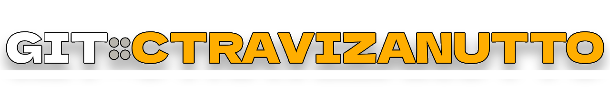

👋 Oi! 🇧🇷 software engineer

### About me
- I'm Cainan Travizanutto
- Full stack developer at Unimed Ponta Grossa and co-founder of MoonRock
- Master's student in Computer Science at UTFPR (process mining in healthcare)
- I research **Code Generation to BDI Agents from Controlled Natural Language (CLAG)**
- I work with AI tools (Cursor, Claude Code, OpenCode, T3) and DevOps

    

### How to reach me

    
&nbsp;
&nbsp;
    

